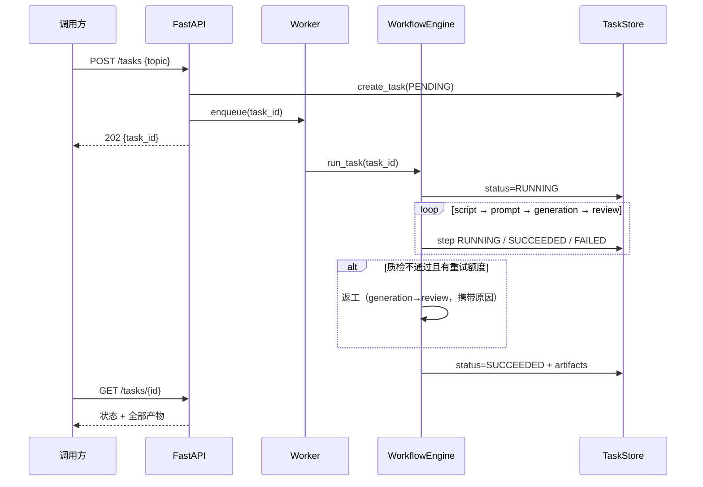
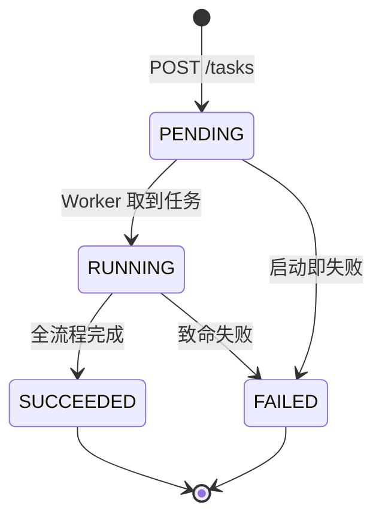
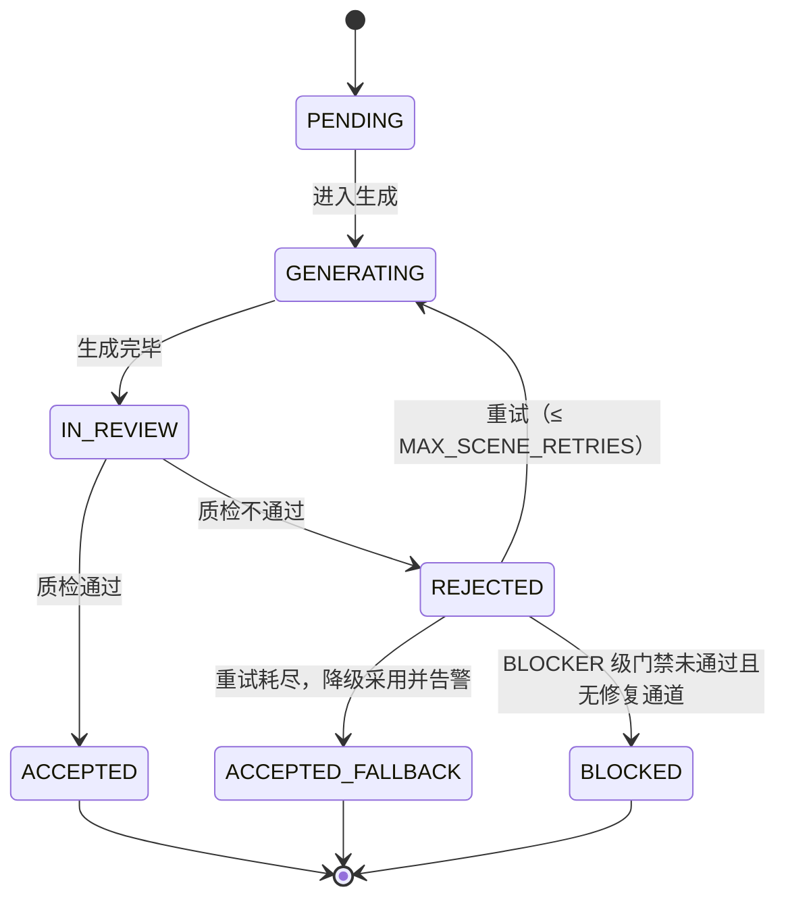

# 架构设计：AIGC Multi-Agent 视频生产 Workflow（v1）

> 配套 PRD：`01-PRD.md`。本文回答"系统长什么样、为什么这么设计"。

## 1. 总体架构

四层：**API 层 → 调度层 → 执行层（Agent 流水线）→ 能力层（LLM / 生成 Provider / 持久化）**。

```mermaid
flowchart TD
    U[调用方] -->|POST /api/v1/tasks| API[FastAPI 路由层]
    API -->|落库 PENDING| STORE[(TaskStore\nSQLite)]
    API -->|task_id 入队| Q[进程内任务队列 queue.Queue]
    API -->|202 + task_id| U
    Q --> W[Worker 线程]
    W -->|状态驱动| WF[WorkflowEngine]
    WF --> A1[Script Agent\n分镜脚本]
    A1 --> A2[Prompt Agent\n生成提示词]
    A2 --> A3[Generation Agent\nTool Calling]
    A3 --> A4[Review Agent\n质量门禁]
    A4 -.质检不通过.-> A3
    A4 --> A5[Compose Agent\n剪辑合成]
    A5 --> V[final.mp4\n真实可播放成片]
    A3 --> T1[generate_keyframe_image]
    A3 --> T2[generate_video_clip]
    T1 --> P[GenerationProvider\nMock / 即梦(v2)]
    T2 --> P
    WF -->|步骤/事件/产物| STORE
    U -->|GET /api/v1/tasks/:id| STORE
```

一次任务的时序：



## 2. 状态机设计（本项目的主角）

状态机是**通用组件**（`app/core/state_machine.py`）：一张流转表 + 守卫函数，任务级与镜头级复用同一套机制，只是表不同。非法流转直接抛 `IllegalTransitionError`——bug 在第一现场暴露，而不是静默吞掉。

### 2.1 任务级



### 2.2 镜头级（对应蛋壳黑陶"逐段验收/返工"的真实经验）



> 设计讲解：真实业务里"质检不通过"不一定是致命错误——有限重试 + 降级 + 告警，比"一失败就整体 FAILED"更接近生产系统的做法。
>
> 但"降级采用"只对**美学/规格类**失败成立。合规类失败（广告法极限词）一旦被降级采用，
> 违规文案会随旁白字幕进入成片并对外交付——所以 `ACCEPTED_FALLBACK` 不能是唯一的兜底出口。
> `BLOCKED` 承载"不予交付"：只有经质检判定 REJECTED 才可进入，且为终态（见决策 D10）。

## 3. 数据模型（SQLite 三表）

| 表 | 关键字段 | 作用 |
|---|---|---|
| `tasks` | id, topic, product_info, scene_count, status, current_step, error, warnings(JSON), artifacts(JSON), created_at, updated_at | 任务主体 |
| `steps` | task_id, name, status, attempt, output(JSON), error, started_at, finished_at | 步骤历史（重试会出现 attempt=2 的同名步骤） |
| `task_events` | task_id, ts, step, message | 生命周期留痕（演示时可直接查询） |

`artifacts` 是 JSON 字典，五个 key：`storyboard`（分镜脚本）、`prompts`（逐镜提示词）、`generation`（素材清单+次数）、`review_report`（质检报告）、`scene_states`（镜头级状态快照）。

### 3.1 规范化产物目录（Session 3）

DB 存"状态与记录"，磁盘存"可交付产物"。每个任务固定布局（`app/core/output_layout.py` 是唯一布局定义，改布局只动这一个文件）：

```
outputs/<task_id>/
├── 00_task.json          任务元信息 + 镜头级状态快照（Exporter 写；失败任务也会导出审计包）
├── 01_script/            storyboard.json + 分镜脚本.md（Exporter 写）
├── 02_prompts/           prompts.json + 提示词.md（Exporter 写）
├── 03_keyframes/         关键帧（Provider 生成时写入）
├── 04_clips/             镜头片段（Provider/Compose 写入）
├── 05_review/            review_report.json（Exporter 写）
└── 06_final/             final.mp4（Compose 写入）
```

## 4. 模块职责与目录

```
aigc-agent-workflow/
├── app/
│   ├── main.py               # FastAPI 入口（应用工厂 + lifespan 启停 Worker）
│   ├── config.py             # 配置（只从环境变量/.env 读，含 MOCK 开关）
│   ├── api/                  # API 层：路由 + 请求/响应模型
│   ├── core/                 # 调度层：state_machine / task_store / workflow / models
│   ├── agents/               # 执行层：base + script / prompt / generation / review / compose
│   ├── tools/                # 能力层：Tool 注册表 + 生成 Provider（mock/pollinations/jimeng 占位）+ 渲染（PIL/ffmpeg）
│   └── llm/                  # 能力层：DeepSeek 客户端 + JSON 解析工具
├── tests/                    # pytest：状态机 / 流水线（含重试路径）/ API
├── docs/                     # PRD / 架构 / 调研 / 开发日志
├── scripts/                  # run.ps1 / test.ps1
└── requirements.txt
```

## 5. Agent 契约（Sub-Agent 组件化）

所有 Agent 继承 `BaseAgent`，统一接口 `run(ctx) -> AgentResult`；基类统一处理日志、计时、异常捕获，子类只写 `_execute`。**Agent 之间不互相通信**，数据通过 `ctx.artifacts` 里的结构化产物传递（Artifact 驱动，每个 Agent 只背上一步的产物，不背全量历史——这正是解决"上下文越滚越长"的正确姿势）。

| Agent | 输入 | 输出（artifact key） | 模式 |
|---|---|---|---|
| ScriptAgent | topic + product_info + scene_count | `storyboard`：分镜脚本 JSON | 真实=DeepSeek 写脚本；Mock=确定性三段式（钩子/卖点/转化） |
| PromptAgent | `storyboard` | `prompts`：逐镜 image_prompt / video_prompt / first_frame_desc | 真实=DeepSeek；Mock=模板拼接 |
| GenerationAgent | `storyboard` + `prompts` | `generation`：素材清单 clips + attempt | **Tool Calling**：LLM 决定调用顺序，程序真实执行（见 §6） |
| ReviewAgent | 上述全部 + 磁盘文件 | `review_report`：逐镜裁决（人读 `reasons` + 机器读 `findings`）+ 规则版本 | 规则引擎（v1 零成本、确定性；v2 加 LLM 复核） |

> `findings` 是 `Finding(rule_id, field, message, owner, severity)` 列表，与 `reasons` 同源同序同数量。
> **owner 与 severity 两轴正交**：owner 回答"谁修"（决定返工路由），severity 回答"修不好还能不能交付"
> （决定交付策略）。只有一轴都不够——只有 owner 则合规文案照样出货，只有 severity 则返工确定性空转（见 D10）。
| ComposeAgent | 分镜 + 素材清单 | `compose`：final.mp4 路径 + 镜头片段清单 | 真实镜头 MP4 直接拼接；否则 PIL 渲染关键帧 + 字幕叠加 + ffmpeg zoompan 合成 |

> 成片剪辑细节：镜头内 = 关键帧 + 字幕叠加 + zoompan 推近；镜头间 = `xfade` 淡入淡出转场（Session 3，消除"PPT 硬切"），失败自动回退直连拼接。

## 6. Tool Calling 设计（Generation Agent）

标准 function calling 机制，抽象成可复用组件 `tools/registry.py`：

1. **菜单**：`ToolRegistry.openai_schema()` 生成 OpenAI function calling 格式的 JSON Schema（`generate_keyframe_image`、`generate_video_clip` 两个工具）。
2. **点菜**：LLM 返回 `tool_calls`（先关键帧图、后图生视频，并把关键帧路径传给后者——复刻蛋壳黑陶的首尾帧衔接经验）。
3. **执行**：`registry.dispatch()` 真正执行，工具内部调用当前 `GenerationProvider`。
4. **回传**：工具结果以 `role=tool` 消息喂回，直到 LLM 不再点菜。

Mock 模式下，Generation Agent 用一份确定性的"点菜单"模拟 LLM 决策，但走**完全相同**的 `dispatch` 路径——机制不因省钱而改变，这是 Mock 的正确用法。

## 7. 关键设计决策（ADR 摘要）

- **D1 为什么 v1 不用 Redis/Celery？** 视频生成是长耗时任务，"提交立即返回 + 后台执行 + 轮询查询"的形态才是重点。v1 用"进程内队列 + Worker 线程"把这条边界画清楚；队列是注入的接口，v2 换成 Redis 只动调度层，不动引擎与 Agent。讲得清"为什么要异步、幂等怎么做、失败重试怎么设计"比"装没装 Redis"重要。
- **D2 为什么 SQLite 而不是内存字典？** 服务重启不丢任务，演示更有说服力；且只用 stdlib，零依赖成本。Store 只负责读写，合法性由状态机保证——v2 换 Postgres/Redis 不碰 workflow。
- **D3 为什么生成用 Mock？** 真实即梦 API 要花钱、要额外密钥；Provider 抽象（`generate_image` / `generate_video_clip`）已就位，v2 写一个 `JimengProvider` 即可，上层零改动。占位文件 `tools/providers/jimeng_provider.py` 写清了真实接入要做的事（异步任务：提交→轮询→取结果，与真实电商内容生产业务同构）。
- **D4 为什么质检 v1 用规则而不是 LLM？** 规则确定、可测试、零成本，且直接来自作者大赛的 7 条质检经验（广告法极限词检查也在其中）。v2 再加 LLM 语义复核，规则层保留为第一道门禁。
- **D5 默认 MOCK_LLM=1。** 防止误花 API 费用；要跑真实模式必须显式 `MOCK_LLM=0`，是刻意的"安全默认值"。
- **D6 不引入 LangGraph 等编排框架。** v1 目标是手写一个能讲清原理的最小引擎；LangGraph 的状态图/持久化思路已在调研文档中对照记录，v2 可选迁移。
- **D7 零成本出真视频（Session 2）。** 用户明确即梦太贵。路线：真实 LLM（DeepSeek）+ 免费真实图片（Pollinations，可选、网络不通可回退）+ 本地 ffmpeg 合成（字幕/运镜/拼接，必选）。关键设计：成片能力放在 ComposeAgent 而不是 Provider——任何 Provider 只要给出关键帧就能出片；日后换真视频模型只动 Provider。
- **D8 对 LLM 输出永远做防御（Session 2 两次真实事故换来的）。** ① 质检原因必须喂回返工提示词，否则 LLM 会重复犯错；② LLM 偶尔不遵守 JSON 契约，PromptAgent 内置确定性"兜底合成"修复层。要点：真实系统里 LLM 输出是不可靠依赖，工程层必须兜底。
- **D9 产物双轨：DB 记录 + 目录交付（Session 3）。** 任务状态/步骤/事件在 SQLite（供 API 查询与审计）；可交付产物按规范目录落盘（供人查看与下游消费）。`export_dir` 写回 artifacts，两边互查。布局集中在 `output_layout.py`，未来接对象存储（OSS/S3）只需换 Exporter 的写入端。

- **D10 Verdict 必须成为 Delivery Gate（Session 6）。** 质检裁决与交付资格曾经脱钩：所有规则失败共用一条策略（重试耗尽 → `ACCEPTED_FALLBACK` → 任务 SUCCEEDED），而 ComposeAgent 只读 `storyboard`、不读 `scene_states`，于是合规不合格的旁白会被烧成字幕进入 `final.mp4`，任务对外仍报成功（运行时实测已证实，仓库历史数据中同一模式也真实发生过两次）。修法分两轴：**owner**（`script`/`prompt`/`generation`，决定返工该重跑哪一步）与 **severity**（`BLOCKER`/`MAJOR`/`MINOR`，决定修不好之后能不能交付），两轴正交、缺一不可。`BLOCKER` 级发现在无修复通道时直接置 `BLOCKED` 终态并让任务 FAILED——既不浪费返工额度（重跑注定得到逐字相同的裁决），也不允许违规内容出货。**刻意不新增 `ApprovedSceneManifest` 之类的 artifact**：`scene_states` 已经是交付资格的事实载体，再造一层只会多一处漂移。同理**不引入 `scope` 第三轴**：当前规则全部是镜头级，scope 在实现上是 owner 的函数而非独立事实；等出现跨镜头规则（如前后镜主体一致性）再提升为字段。
- **D11 确定性修复优先于生成式重试；审计包不分成败（Session 6）。** ① 能确定性修复的缺陷不要重新调用生成模型——`ScriptAgent._clamp_durations` 已为 R4 落地此原则，合规类（R6 旁白）应对称地补 `_sanitize_narration`，而不是赌下一轮 LLM。约束：只允许“移除违规声明”这类单调变安全的改写，且必须留痕（原文 + 改后 + 触发规则写进 `task_events`）——一个以双轨留痕为卖点的项目不能静默改写文案。② `export_task_bundle` 原先只在 SUCCEEDED 路径调用，导致 FAILED 任务没有任何磁盘产物；而合规拦截恰恰是最需要审计留痕的场景。现改为成功与失败双路径都导出（`WorkflowEngine._export_bundle`），并保持“状态最后写”契约，使 `00_task.json` 里的 `status` / `scene_states` 一定是终态快照。
- **D12 已知缺陷用 `xfail(strict=True)` 固化，不用注释（Session 6）。** 仓库必须保持 pytest 全绿，但“绿色”不能掩盖已知缺陷。做法是把缺陷写成断言正确行为的测试并标 `xfail(strict=True)`：修复落地后测试会 XPASS，strict 让 pytest **失败**，强制在同一次提交里摘掉标记。缺陷因此不会“修好了但测试还记着它坏了”，也不会“悄悄变绿没人注意”。当前保留 1 条 xfail（提示词级失败的返工路由），它会在后续计划落地时转为 passed。

- **D13 非法流转不得静默吞掉；返工清单由状态机推导而非报告推导（Session 7）。** 原 `_move_scenes` 把 `IllegalTransitionError` 吞成 warning 继续跑，与本文 §2 的表述矛盾；更严重的是它掩盖了一条可达的静默错乱路径：`rejected` 原先由**质检报告**推导，而 `_apply_verdicts` 遇到「已 ACCEPTED 但本轮报告判不通过」时因终态不可流转而静默跳过，于是该镜头仍留在 `rejected` 里被无谓重新生成，并触发两次被吞的非法流转（`ACCEPTED→GENERATING`、`ACCEPTED→IN_REVIEW`），最终状态机说 ACCEPTED、报告说 failed、行为是重生成过，三者互相矛盾而对外只有 SUCCEEDED。唯一可达触发路径是 R3（它检查磁盘文件是否存在，已 ACCEPTED 镜头的素材在两轮之间消失即翻转）。修法三步且顺序不可颠倒：① `_apply_verdicts` 区分「真幂等」与「终态 vs 新裁决矛盾」，后者记 warning + event 留痕、状态不回退；② `rejected` 改由 `_rejected_scenes()` 从状态机推导，使四个 `_move_scenes` 调用点**按构造合法**；③ 此时才去掉吞异常，让非法流转在第一现场抛出。**关键顺序理由**：先做 ③ 会把一个本可完成的任务变成崩溃——合法性必须先成为结构性保证，再让守卫真正生效。矛盾时的策略取「记警告并继续」而非「判任务 FAILED」：终态是设计意图，且镜头内容未变、首轮 ACCEPTED 判断依然有效，因外部删文件就整单失败对调用方过脆。

## 8. 演进路线（v2 清单）

1. `JimengProvider` 接入火山引擎即梦 API（异步任务轮询模式）——用户决定暂不申请（成本），接口占位已留。
2. Redis 队列 + 多 Worker，任务幂等键，压测并发。
3. RAG：商品资料/考古资料切块检索（chromadb），喂给 Script Agent。
4. 成片增强：BGM、转场、真实配音（TTS）；当前版本为字幕 + 运镜 + 拼接。
5. Docker 化 + 结构化日志 + P95 延迟等 SLA 指标。
6. **返工路由（owner routing）**：按 `Finding.owner` 重跑对应步骤，而不是无条件重跑 generation；`PromptAgent` / `ScriptAgent` 支持 `ctx.extra["scene_ids"]` 局部返工（照 `GenerationAgent` 的现成模式）；`_sanitize_narration` 落地后把 `("R6","narration")` 登记进 `REPAIR_ACTIONS`。
7. **可观测性**：`GET /api/v1/metrics`（成功率 / 平均返工次数 / 降级率 / 拦截率 / P50-P95 时长 / 规则失败分布 / 返工路由分布）；成本指标需先补 instrumentation——`llm/client.py` 当前丢弃响应 `usage`，落点为 `BaseAgent.meta` → `steps.output`，并把 `gen_provider` / `mock_llm` 落库以便归因。未落库前只输出 `estimated_cost` 并明确标注。
8. **并发隔离**：`WorkflowEngine._scene_machines` 是实例级可变状态，当前“每任务开头重置”只在单 Worker 前提下成立，多 Worker 前必须移入 per-task 执行上下文；stale RUNNING 任务恢复。（原列于此的“移除 `_move_scenes` 吞异常”已于 Session 7 完成，见 D13。）
9. **合成语义一致性**：Provider 不再借用合成层函数（`pollinations_provider.generate_video_clip` 目前直接调 `render_scene_video`），只返回 raw media，后处理统一归 Compose；前置缺口是 `overlay_subtitle` 只支持静图，真视频叠字幕需新增 ffmpeg `drawtext` 路径。规则校准：R2 关键词只从 `product_info` 抽且要求 ≥2 命中，R6 补 `第一次/第一眼` 排除与 `销量冠军/行业领先/绝无仅有` 等高风险词。
