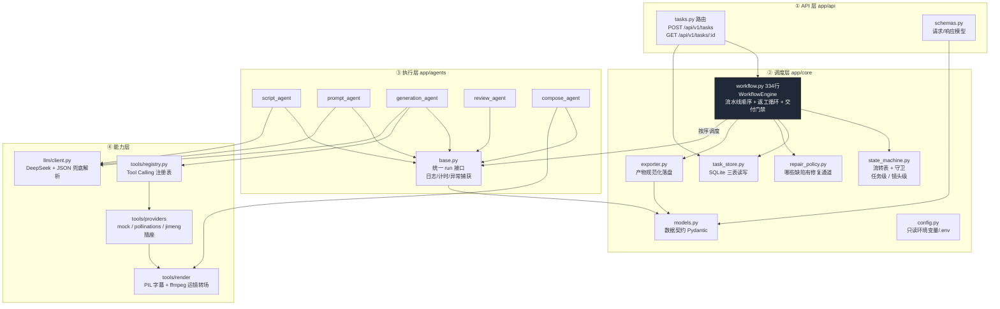
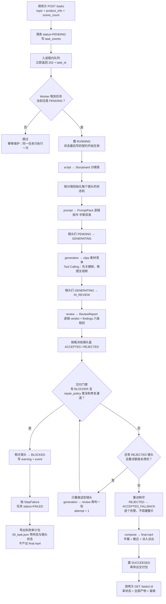
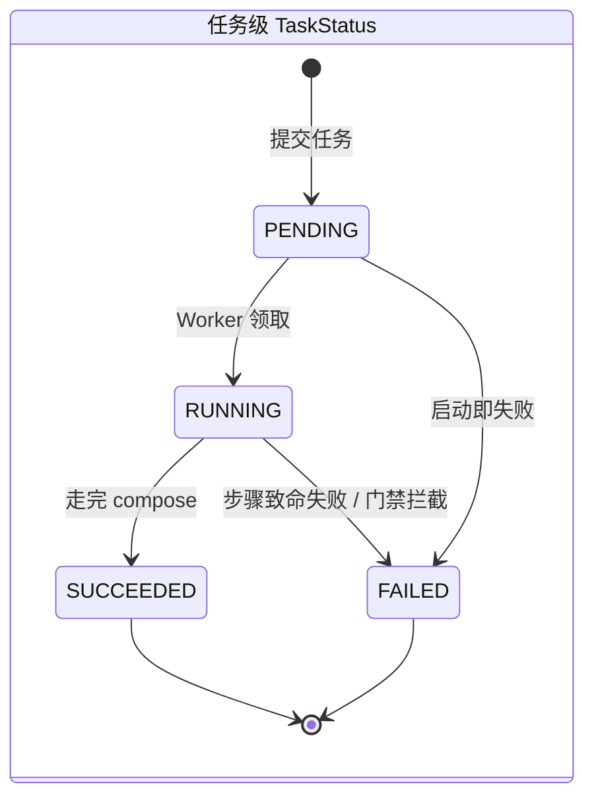
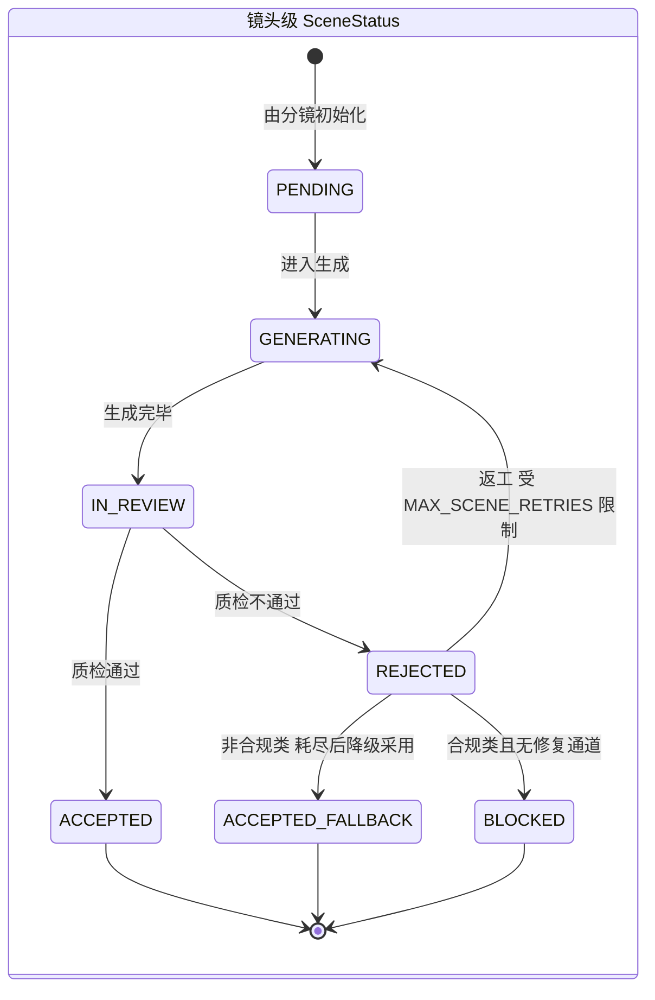
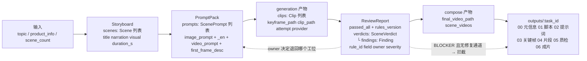
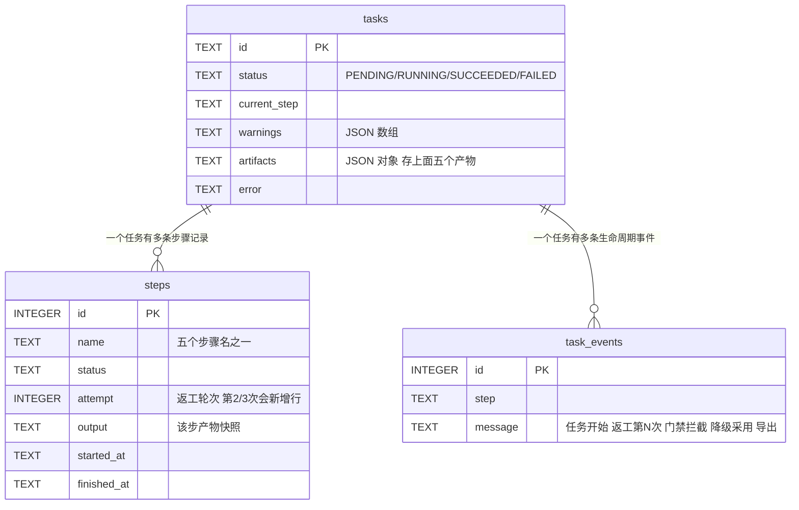

# 架构图解（4 张图对齐颗粒度）

> 本文件**只画图**。设计决策的理由以 `02-架构设计.md` 的 ADR D1~D13 为准，
> 过程记录以 `dev-log.md` 为准。若本文件与代码不一致，以代码为准并请修正本文件。
>
> 每张图前面写了"它回答哪个问题"。看哪张取决于你当下想搞清楚什么。

---

## 图 1｜代码在哪、谁依赖谁

回答：**"我想改 X，该动哪个文件？"** 箭头方向 = 依赖方向（上层依赖下层，反向不允许）。

**看图要点**

- `workflow.py` 是唯一有编排逻辑的地方（深色框）。想加工位、改返工策略、改门禁，都在这里；五个 Agent 都不知道彼此存在。
- 状态合法性只在 `state_machine.py`；持久化读写只在 `task_store.py`；"能不能修"只在 `repair_policy.py`。三件事分开，是为了换数据库/换队列时不动业务代码。
- `generation_agent.py` 210 行最厚，因为它同时管 Tool Calling 循环、返工反馈注入、漏镜补做、素材合并。

---

## 图 2｜一个任务的一生（含返工与被拦截）

回答：**"数据怎么流？什么时候会失败？"** 实线是主路径，右侧分支是拦截路径。

**看图要点**

- 顺序是 `script → prompt → generation → review → compose`，中间**没有任何一步知道上一步是谁**，只读 `ctx.artifacts` 里的产物。
- 返工只重跑 `generation` 和 `review`。所以缺陷归属在上游（提示词/分镜）时，返工改变不了裁决——这是目前仍标记为"未修"的那一项。
- 交付门禁在 `compose` **之前**：合规不合格根本不会进入剪辑环节，所以成片里不可能出现违规旁白。
- `00_task.json` 里的 `status` 一定是终态，因为导出发生在状态落定之后（先写状态再导包）。

---

## 图 3｜双层状态机（合法流转的唯一真相）

回答：**"某个状态还能去哪？"** 图里没有的箭头，代码会在第一现场抛 `IllegalTransitionError`。

**看图要点**

- 两个终态 `ACCEPTED` / `ACCEPTED_FALLBACK` 表示"可以出货"；`BLOCKED` 表示**不许出货**，且它是从 `REJECTED` 才进得去——不能绕过质检直接拦。
- `ACCEPTED` 是终态、不回退。曾出现"复检说不合格但状态已是 ACCEPTED"的矛盾，那属于数据不一致，现在记告警留痕而不是改状态。
- 状态转移是纯内存组件，落库由 `task_store` 做。**这两者分离正是扩展性问题的来源**，也是它现在只能跑单 Worker 的原因（见 `02-架构设计.md` 演进路线第 8 项）。

---

## 图 4｜数据契约：谁交出什么、记在哪

回答：**"步骤之间传的东西长什么样？出了问题我查哪张表？"**

**看图要点**

- `steps` 表是**返工是否真的有效**的唯一可靠证据来源。同一 `name` 出现 `attempt=1,2,3` 说明重跑了；`output` 字段里存着那一轮的裁决，把三轮的 `output` 规范化比对即可判断结论有没有变化。
- `artifacts` 是一个 JSON 列，键就是 `storyboard / prompts / generation / review_report / scene_states / compose / export_dir`。**它是整块读改写**，所以并发下会丢更新（演进路线第 3 项要拆它）。
- 虚线两条是本轮加的语义：`Finding.owner` 指向"该退回哪个工位"，BLOCKER 直接决定"能不能出片"。

---

## 附：当前实现的边界（看图时别误读）

| 图里看起来有 | 实际状态 |
|---|---|
| generation 会重做 | 只重做质检不通过的镜头；缺陷在上游产物时属于无效重做，**已用 1 条 xfail 测试标注未修** |
| providers 三档 | `jimeng` 是**空插座**，未接任何付费视频模型 |
| compose 产出成片 | 真实图档走"直接拼接"分支，**旁白不会烧成字幕**（只测试档生效） |
| 队列 + Worker | 进程内队列，**不支持多 Worker**；进程重启后 PENDING 任务丢失、RUNNING 任务永久卡住 |
| 双层状态机 | 镜头状态存在内存实例上，落库靠另一个对象，两边可能不一致（已通过 F15 修复，但结构未变） |
| 全程留痕 | 有 `warnings`/`00_task.json`，**没有指标聚合接口，也没有成本计量** |

这些都已写在 `README.md` 的「已知限制」里，不是本图新增的坏消息。
